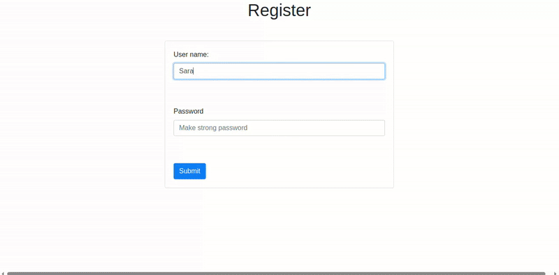

# mini_social

A small social web app written in Python with raw PostgreSQL (`psycopg2`, no ORM).
Users can write posts and follow each other. I built it to practice PostgreSQL: schema design, queries and working with the database from Python.



## Features

- Create, edit and delete your own posts
- Follow and unfollow other users

**Not implemented:** profile editing, tagging, search.

## Tech stack

Python · PostgreSQL · psycopg2

`memory-profiler` and `psutil` are also in `requirements.txt`.

## Project structure

| File | Purpose |
|---|---|
| `config_db.py` | Database connection settings |
| `connect.py` | Checks that the connection to the database works |
| `schema.py` | Creates all tables |
| `main.py` | Starts the web app |
| `requirements.txt` | Python dependencies |

## Getting started

**Requirements:** Python 3.<x>+ and a running PostgreSQL server.

1. Clone the repository and create a virtual environment:

   ```bash
   git clone https://github.com/yazmyrad/mini_social.git
   cd mini_social
   python -m venv .venv
   source .venv/bin/activate        # Windows: .venv\Scripts\activate
   ```

2. Install the dependencies (PostgreSQL itself must be installed separately):

   ```bash
   pip install -r requirements.txt
   ```

3. Create a PostgreSQL database and put your connection settings (host, port, database name, user, password) in `config_db.py`. Then check the connection:

   ```bash
   python config_db.py
   python connect.py
   ```

4. Create the tables:

   ```bash
   python schema.py
   ```

5. Start the app and open it in your browser:

   ```bash
   python main.py
   ```

   Then go to `http://localhost:<port>`.

## What I practiced

- Designing a relational schema for users, posts and follow relationships
- Writing SQL queries and running them from Python with `psycopg2`
- Handling connections and transactions manually

## Ideas for next steps

- Profile editing
- Tags on posts
- Search by users and posts
- Moving database settings to environment variables
